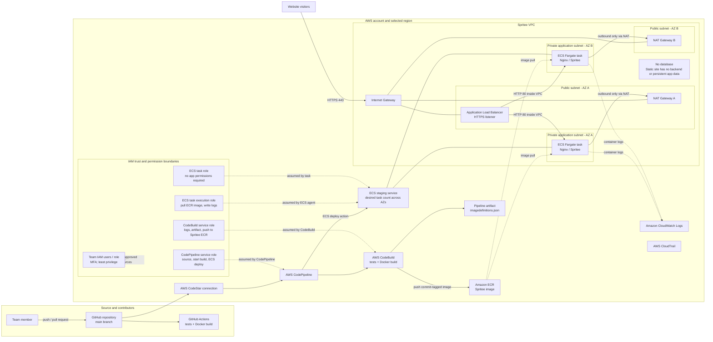

# Phase 1: Spritee Architecture Blueprint

## Project scope

Deploy the existing static Spritee website to an AWS ECS staging service through an automated GitHub-to-AWS CI/CD pipeline.

This is a **staging design**, not a claim that AWS resources have already been created. The selected AWS region, account, domain, and budget still need to be agreed by the group before provisioning.

## High-level architecture

## Network and traffic flow

1. Visitors reach the public Application Load Balancer over HTTPS. The ALB is placed in public subnets in two Availability Zones; an Internet Gateway provides internet routing.
2. The ALB forwards requests to port 80 on the Spritee ECS tasks. The Fargate tasks run in private subnets in two Availability Zones and do not receive public IP addresses.
3. Security groups should allow inbound TCP 443 (and optionally 80 only to redirect to HTTPS) to the ALB. The ECS task security group should allow TCP 80 **only from the ALB security group**. Do not expose SSH or the task port directly to the internet.
4. Private tasks use NAT gateways for outbound access, including pulling images from ECR and sending logs. NAT gateways are billable; check the student budget before creating them. For a cost-limited demonstration, the group can assess one NAT gateway or VPC endpoints, documenting the resulting availability/cost trade-off with the instructor.
5. Route 53 and an ACM TLS certificate can be added if the group has a domain. A domain is not required to test the ALB-provided address.

## Pipeline and IAM boundaries

- **GitHub Actions** runs tests and a Docker build for pull requests and pushes to `main`. It needs repository read access and should not contain AWS credentials.
- **CodePipeline** receives source changes through an AWS CodeStar connection to GitHub. Its service role should be limited to reading that connection/artifact, starting the named CodeBuild project, and deploying to the named ECS service.
- **CodeBuild** runs tests, builds the container, pushes the commit-tagged image to the Spritee ECR repository, and emits `imagedefinitions.json`. Its role needs CloudWatch Logs, pipeline artifact access, and scoped ECR push permissions.
- **ECS task execution role** permits ECS to pull the image from ECR and send container logs to CloudWatch Logs.
- **ECS task role** grants permissions to the application code. Spritee is a static site and calls no AWS APIs, so it should have no additional application permissions.
- **Human team access** should use named IAM identities/roles, MFA, and only the permissions needed for the lab. Do not commit access keys or passwords to the repository.
- **CloudTrail** records AWS account/API activity. **CloudWatch Logs** receives container logs; use CloudWatch metrics/alarms to observe the ALB and ECS service.

## Database decision

No database is included. Spritee currently serves static files and keeps no server-side user accounts or persistent application data. Adding RDS or another database would increase cost and complexity without supporting the assigned application. If the application later gains a backend feature that stores data, revise the design to add a database in isolated private data subnets with encryption and restricted access.

## Phase 1 cloud setup decisions

Before provisioning anything, the group should agree and record:

1. AWS account owner and selected AWS region.
2. A project name/resource naming convention and environment name (`staging`).
3. Budget limit and who will monitor AWS Billing alerts. NAT gateways, ALB, Fargate, and public IPv4 addresses can incur charges.
4. Whether to use a domain/HTTPS certificate or demonstrate with the ALB DNS name.
5. Team IAM access with MFA and the least-privilege roles listed above.

Phase 1 deliverable: this architecture, the recorded setup decisions, and instructor/team approval. Resource provisioning and deployment belong to the subsequent phases.
